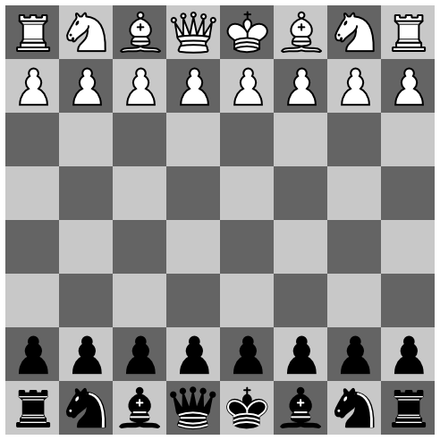
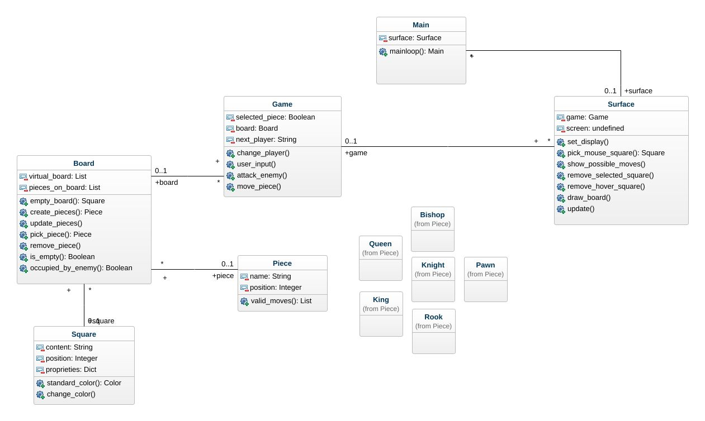

# ♟️ CHESS AI

This is a simple chess game implemented in Python using the pygame library.



## ⚙️ INSTALLATION

- [ Python 3.x ] [ Pygame library ]

1. **Clone the repository**:

```
git clone https://github.com/freschetto/free-chess.git
```

2. **Create Virtual Environment (optional)**:
```
python3 -m venv env_name
```

- Activate on Linux / macOS:  `source env_name/bin/activate`
- On Windows:  `env_name\Scripts\activate`

3. **Install the required dependencies**: 
```
pip install -r requirements.txt
```

## 🎮 Usage

1. Run the main.py file to start the game: `python main.py`

2. The game window will open, displaying the chessboard.

3. Players can take turns selecting and moving their pieces using the mouse. Valid moves will be highlighted on the board.

4. The game follows standard chess rules, including en passant, castling, and pawn promotion.

5. The game will continue until one player is checkmated or a draw is reached. The result will be displayed on the screen.

## 🗂️ UML



## 🔍 ROADMAP

- Create a data structure to represent the chessboard
- Define classes to represent different chess pieces
- Implement logic to generate all possible legal moves for each piece

  
- Create game engine for changes on board
- Develop a graphical user interface (GUI) to display the chessboard and allow players to make moves using mouse clicks

  
- Validate pieces moves if is checkmate (remove from legal moves)
- Implement logic to check for checks and checkmates
- Build en passant and promotion for pawns
- Build castling for kings and rooks

  
- Implement a winning condition (capturing the opponent's king or a draw)
- Create a game loop that handles player moves and updates the board accordingly until the game ends

## 📄 License

This project is licensed under the [MIT License](https://opensource.org/licenses/MIT). See the `LICENSE` file for more details.
